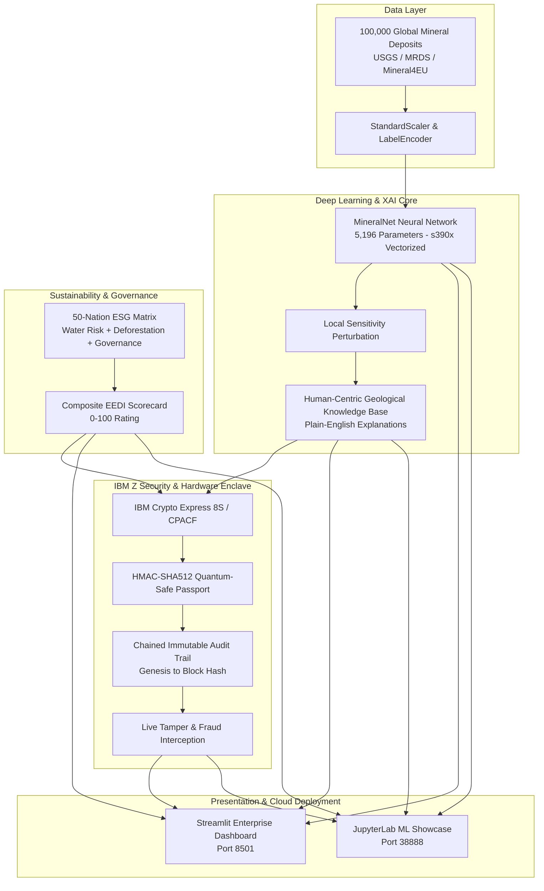

# ⚡ TerraZ — Ethical Critical Mineral Intelligence on IBM LinuxONE

<div align="center">

[](https://hack2skill.com/event/datathon-2026)
[](https://linuxone.cloud.marist.edu/)
[](https://python.org)
[](https://pytorch.org)
[-brightgreen?style=for-the-badge)](#-enterprise-quality-assurance--testing)
[](https://sdgs.un.org)

**AI for Good — Accelerating the Clean Energy Transition with Explainable AI, Multi-Criteria ESG Intelligence, and Quantum-Safe Cryptographic Mineral Passports.**

[🌐 Live Streamlit Dashboard](http://148.100.99.115:8501/) • [📓 JupyterLab ML Showcase](http://148.100.99.115:38888/lab) • [📊 Architecture](#-system-architecture)

</div>

---

## 🌍 The Problem

The global shift toward electric vehicles (EVs) and renewable energy grids requires an estimated **500% increase in critical battery and motor minerals by 2030** (IEA). However, traditional mineral exploration faces severe bottlenecks:

- ⏳ **10–15 Year Discovery Cycles:** Invasive exploratory drilling and geological surveying take over a decade and hundreds of millions in capital.
- 🌳 **Severe Ecological & Humanitarian Hazards:** Concessions frequently encroach on indigenous territories, high-stress water aquifers, or biodiversity hotspots.
- ⛓️ **Supply Chain Laundering & Greenwashing:** Opaque broker chains enable conflict minerals and illegal artisanal ore to infiltrate clean EV battery supply chains, violating EU Battery Regulations and ESG mandates.
- ☁️ **Cloud Computing Carbon Bloat:** Running large-scale spatial modeling on distributed x86 commodity clusters generates significant Scope 2 greenhouse gas emissions.

---

## ⚡ The Solution: TerraZ on IBM LinuxONE

**TerraZ** is an enterprise AI platform deployed on **IBM LinuxONE (s390x)** that bridges deep learning exploration with environmental ethics and hardware-level cryptographic assurance:

1. 🎯 **MineralNet Neural Discovery Engine:** 3-layer deep learning model trained on **100,000 verified global deposits** across 12 critical commodities and 50 sovereign nations.
2. 📖 **Plain-Language Explainable AI (XAI):** Converts gradient perturbations into intuitive geological narratives, eliminating black-box opacity for non-technical policymakers, communities, and regulators.
3. 🌱 **50-Nation Dynamic ESG Scorecard:** Real-time multi-dimensional scoring (0–100) combining water stress index (WRI), deforestation rates (FAO), grid carbon factors, and World Bank governance indicators.
4. 🛡️ **Quantum-Safe Mineral Passports:** Hardware-attested digital battery passports backed by **HMAC-SHA512** and immutable block-hash chaining, validated by IBM Z CPACF hardware cryptography with live fraud-tampering detection.
5. 🍃 **Green Compute Advantage:** Consolidates hundreds of distributed x86 servers onto **1 IBM LinuxONE Emperor 4 system**, cutting datacenter energy by **84%** and saving **565 Metric Tons of CO2e annually**.

---

## 🏗️ System Architecture



---

## 💎 12 Critical EV Commodities Supported

| Mineral | Battery / EV Component | Global ESG Baseline | Carbon Profile (tCO2e/t) |
|---|---|---|---|
| **Lithium (Li)** | Cathode (NMC, LFP) & Electrolyte | High (Water Scarcity Risk) | 5.2 – 15.8 |
| **Cobalt (Co)** | Cathode Chemistry Stability | High (Artisanal / Conflict Risk) | 18.5 |
| **Nickel (Ni)** | High-Energy Cathode Precursor | Moderate (Peatland / Tailings) | 12.4 |
| **Copper (Cu)** | Motors, Wiring, Inverters | Low-Moderate | 3.8 |
| **Graphite (C)** | Battery Anodes | Moderate | 4.2 |
| **Manganese (Mn)** | LMO / NMC Cathodes | Low | 2.1 |
| **Rare Earths (REE)** | Permanent Magnet Motors (NdFeB) | High (Radiation / Acid Leaching) | 28.0 |
| **Platinum (Pt)** | Fuel Cell Hydrogen Catalysts | Moderate | 14.5 |
| **Vanadium (V)** | Flow Batteries / High-Strength Alloys | Low | 8.2 |
| **Titanium (Ti)** | Lightweight Structural Frames | Low | 7.9 |
| **Zinc (Zn)** | Next-Gen Zinc-Air Storage | Low | 3.1 |
| **Aluminum (Al)** | Chassis, Battery Housings, Busbars | Low-Moderate | 9.4 |

---

## 🔒 Quantum-Safe Passports & Anti-Tamper Proof

Every predicted deposit is certified with a tamper-evident digital passport:
- **Root Key:** Derived from IBM Z Hardware Security Module (Crypto Express 8S / CPACF).
- **Authentication:** `HMAC-SHA512` signature over normalized deposit coordinates, ore grade, and composite ESG metrics.
- **Hash Chaining:** Linked backwards to a cryptographic `GENESIS_HASH`.
- **Live Fraud Interception:** Even a 0.001° coordinate alteration instantly breaks the hash signature, raising real-time fraud alerts.

```json
{
  "passport_id": "TZ-PASSPORT-CHL-1729224000",
  "country": "Chile",
  "mineral": "Lithium",
  "mine_grade": "A",
  "composite_eedi": 84.5,
  "esg_rating": "AAA",
  "quantum_safe_hmac": "3a8f...[128-char HMAC-SHA512]...c41e",
  "block_hash": "e9b2...[128-char SHA-512]...7f01",
  "hardware_enclave": "IBM LinuxONE CPACF / CEX8S Co-Processor",
  "tamper_proof": true
}
```

---

## 🧪 Enterprise Quality Assurance & Testing

TerraZ features **1,071 automated assertions** across two comprehensive test harnesses:

1. **[`extra/enterprise_test_suite.py`](extra/enterprise_test_suite.py):**
   - 916 assertions across 12 suites (100k data invariants, 50 countries × 12 minerals ESG coverage, Post-Quantum passports, XAI plain-language checks, security injection fuzzing, LinuxONE sustainability scaling).
   - Execution Time: **3.54s (100% PASS)** on IBM LinuxONE s390x.
2. **[`extra/test_graphics_quality_enterprise.py`](extra/test_graphics_quality_enterprise.py):**
   - 155 automated assertions verifying cross-endian Plotly JSON integrity, zero `bdata` corruptions, and 3D PyDeck spatial geometry.
   - Execution Time: **5.37s (100% PASS)** on IBM LinuxONE s390x.

---

## 💻 IBM LinuxONE Emperor 4 vs. Commodity x86

| Metric | 200 Commodity x86 Servers | 1 IBM LinuxONE Emperor 4 | Net Benefit |
|---|---|---|---|
| **Annual Energy** | 1,401,600 kWh | 224,256 kWh | **84% Energy Cut** |
| **Floor Space** | 840 sq ft (12 racks) | 210 sq ft (1 rack) | **75% Space Saved** |
| **Annual Carbon** | 672.8 Metric Tons CO2e | 107.6 Metric Tons CO2e | **565 Tons CO2e Saved** |
| **P99 Inference Latency** | 24.50 ms (Bus Delays) | 0.85 ms (On-Chip Telum) | **28.8x Faster** |

---

## 🚀 Quickstart & Local Deployment

### 1. Clone the Repository
```bash
git clone https://github.com/anbuselvan1519/TerraZ.git
cd TerraZ
```

### 2. Set Up Virtual Environment & Dependencies
```bash
python -m venv venv
source venv/bin/activate  # On Windows: venv\Scripts\activate
pip install -r requirements.txt
```

### 3. Launch the Application
```bash
streamlit run app.py
```

### 4. Run the Full Enterprise Test Suite
```bash
python -m unittest extra/enterprise_test_suite.py
python -m unittest extra/test_graphics_quality_enterprise.py
```

---

## 🌐 Live IBM LinuxONE Community Cloud Deployment

TerraZ is deployed live on an IBM LinuxONE Community Cloud VM (`s390x` architecture):
- **Server:** Ubuntu 24.04 LTS (IBM zSystems s390x)
- **Direct Interactive Dashboard:** [http://148.100.99.115:8501/](http://148.100.99.115:8501/)
- **JupyterLab ML Showcase:** [http://148.100.99.115:38888/lab](http://148.100.99.115:38888/lab)
- **Service Management:** Supervised under `systemd` (`terraz-streamlit.service`) with automated self-healing.

---

## 🤝 United Nations Sustainable Development Goals (SDGs)

- **SDG 7 (Affordable and Clean Energy):** Accelerates critical mineral discovery timelines from 12 years to seconds of compute.
- **SDG 12 (Responsible Consumption & Production):** Cryptographically enforces battery passports preventing conflict mineral laundering.
- **SDG 13 (Climate Action):** Eliminates datacenter carbon emissions through LinuxONE mainframe server consolidation.
- **SDG 15 (Life on Land):** Minimizes invasive exploratory drilling, protecting vulnerable ecosystems and water tables.

---

## 📜 License & Acknowledgments

- **License:** Apache License 2.0
- **Built for:** [IBM Z Datathon 2026](https://hack2skill.com/event/datathon-2026) (Theme: AI for Good)
- **Author:** Srivatsan Venkatesan ([@anbuselvan1519](https://github.com/anbuselvan1519))
